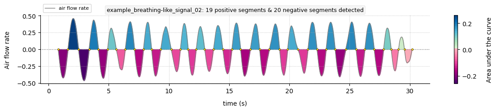
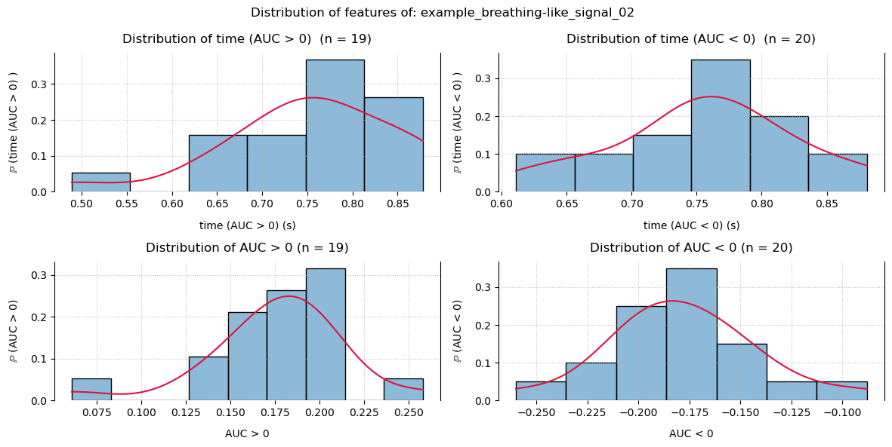
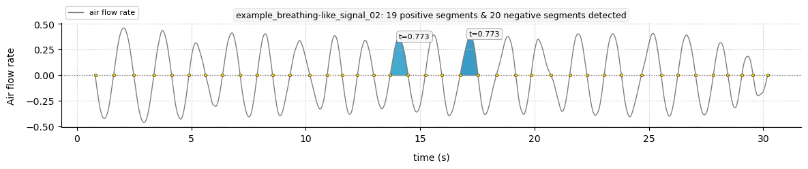
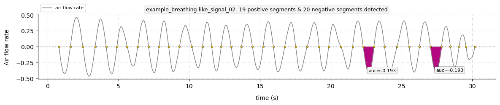

# pybreathe: a python package for respiratory air flow rates analysis

## Get started

First of all, we highly recommend that you install [miniconda](https://www.anaconda.com/docs/getting-started/miniconda/install) on your machine.

To set up the virtual environment required for respiratory flow analysis, open **Anaconda prompt** and please run (only the first time):

```bash
$ conda create --name pybreathe
$ conda activate pybreathe
$ pip install pybreathe
$ conda install conda-forge::jupyterlab
```

If you encounter an error stating that `pip` cannot be found, then run: `$ conda install anaconda::pip`

Then, every time you want to analyze data, open **Anaconda prompt** and activate the virtual environment with:

```bash
$ conda activate pybreathe
```

(do not reinstall `pybreathe` each time)

To get started with `pybreathe` API, we strongly recommend that you use and refer to the example scripts. The package comes with [example scripts](https://github.com/tcoustillet/pybreathe/tree/main/examples) based on simulated breathing signals that are representative of the data that can be collected experimentally. They explain the milestones involved in carrying out an analysis (feature extraction) and they supply useful documentation.

Run the example script (or any other) with:

```bash
$ jupyter lab example.ipynb
```

> /!\ You must either be in the same directory as your .ipynb file, or specify the absolute path. You can either move to your directory with the `$ cd` command (_e.g._, `$ cd algo/test`) or you can type the command : `$ jupyter lab ` and then drag and drop your file into the terminal. This will automatically copy the absolute path of your file: `$ jupyter lab '/home/tcoustillet/algo/test/example.ipynb'`

Once the example notebook is open, you can run the cells one by one and understand how `pybreathe` works. To analyse your own data, create a new notebook and refer to the examples for how the API works.

Finally, to quit the analysis, please follow these steps:

- Right clic on your .ipynb file in the tree, then "Shut Down Kernel"
- Clic on "File", the "Shut Down"
- When you regain control in your terminal, run:

```bash
$ conda deactivate
```

## Examples

### Plotting a time series

```python
from pybreathe import BreathingFlow

bs = BreathingFlow.load_breathing_like_signal_02()[:7500]
bs.plot(show_auc=True)
```



### Getting inspiratory and expiratory times

```python
bs.get_negative_time(save=True)
# mean = 0.756 ± 0.0692 (n = 20; var = 9.15 %).
# (0.756, 0.0692, 20, 9.15)
```

```python
bs.get_positive_time(save=True)
# mean = 0.751 ± 0.0937 (n = 19; var = 12.5 %).
# (0.751, 0.0937, 19, 12.5)
```

### Getting inhaled and exhaled volumes

```python
bs.get_negative_auc(save=True)
# mean = -0.178 ± 0.0363 (n = 20; var = 20.4 %).
# (-0.178, 0.0363, 20, 20.4)
```

```python
bs.get_positive_auc(save=True)
# mean = 0.175 ± 0.0386 (n = 19; var = 22.1 %).
# (0.175, 0.0386, 19, 22.1)
```

### Getting an overview of times and volumes

```python
bs.plot_distribution()
```



### Getting frequency

```python
bs.get_frequency(save=True)
# 42.0
```

### Highlighting a time or volume

```python
bs.get_positive_time(return_mean=False)
"""
(0.878,
 0.776,
 0.723,
 0.764,
 0.675,
 0.869,
 0.651,
 0.705,
 0.773,
 0.722,
 0.773,
 0.848,
 0.856,
 0.75,
 0.749,
 0.86,
 0.776,
 0.634,
 0.489)
 """
```

```python
bs.plot(highlight_time=(0.773,))
```



```python
bs.get_negative_auc(return_mean=False)
"""
(-0.22,
 -0.26,
 -0.209,
 -0.142,
 -0.194,
 -0.185,
 -0.153,
 -0.163,
 -0.151,
 -0.174,
 -0.198,
 -0.185,
 -0.165,
 -0.164,
 -0.193,
 -0.214,
 -0.184,
 -0.193,
 -0.123,
 -0.088)
 """
```

```python
bs.plot(highlight_auc=(-0.193,))
```



To make the most of all the package’s features and use the API correctly, please go to: [](https://github.com/tcoustillet/pybreathe/tree/main/examples/)
